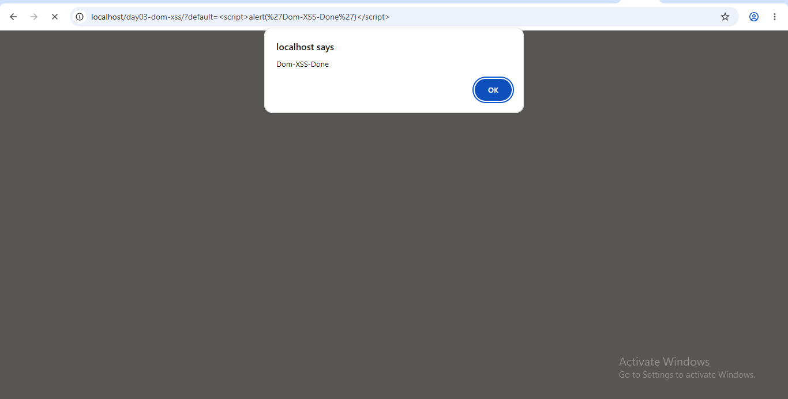
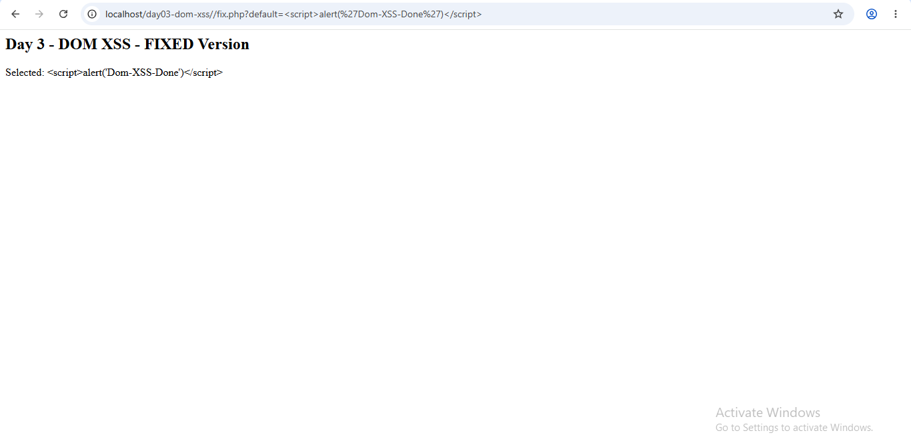

# Day 03 - DOM XSS Lab

### Vulnerable - index.php
`document.write` uses user input as HTML

Payload: `?default=`

### Fixed - fix.php
`innerText` treats input as text only

Payload becomes harmless text - SECURE!

### Learning
- OWASP A03 Injection
- Never use innerHTML / document.write with URL params
- Fix: innerText + validation
